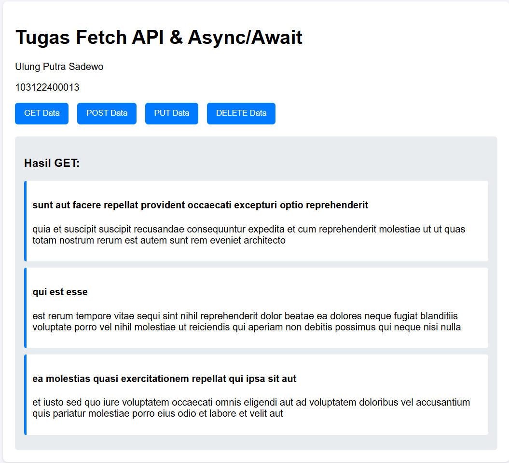
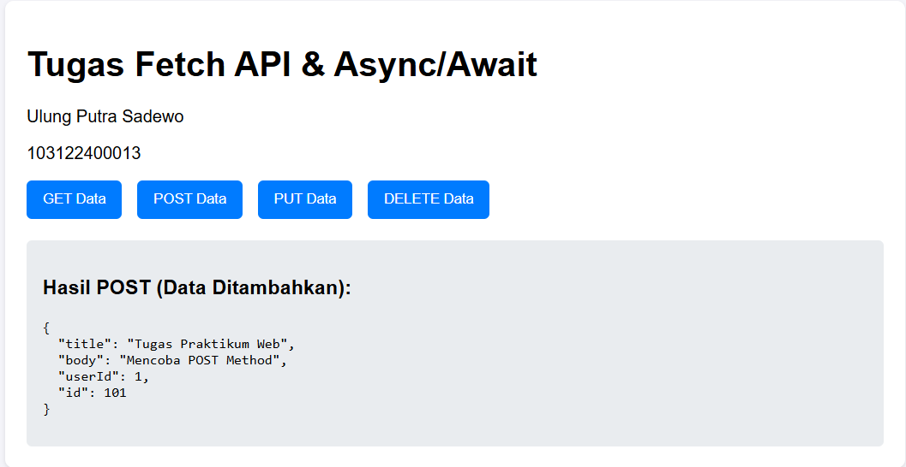
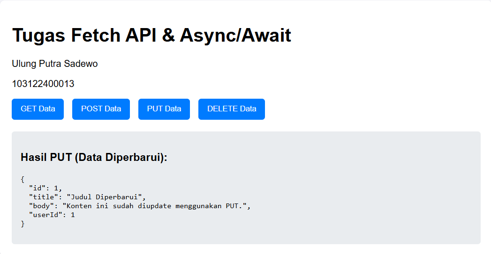
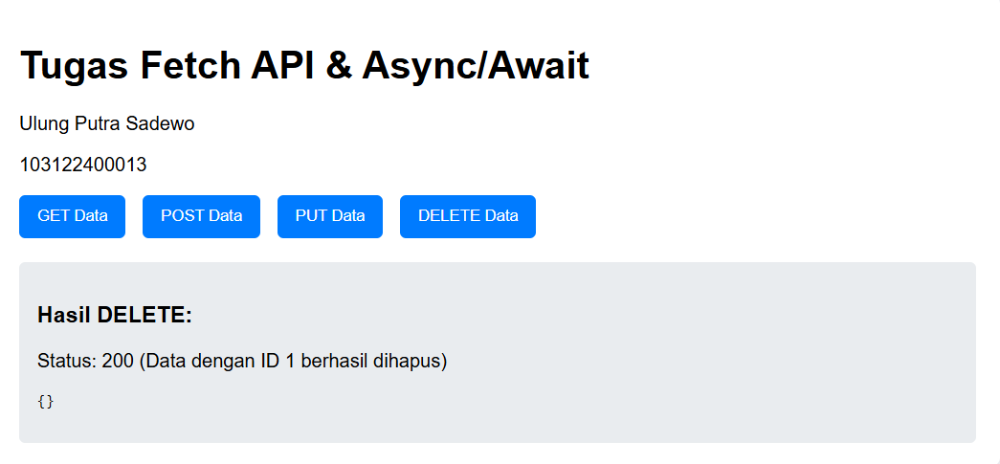

Web sederhana yang mengimplementasikan Fetch API. Setiap metode HTTP memanggil endpoint JSONPlaceholder dan menampilkan hasilnya secara langsung ke halaman HTML. Respons API juga dapat diperiksa melalui area Respons API yang menampilkan JSON mentah.

## Screenshot Output

### GET — Ambil Data


### POST — Tambah Data


### PUT — Update Data


### DELETE — Hapus Data


## Struktur File

```
103122400013_Ulung Putra Sadewo/
├── README.md
├── screenshoot/
│   ├── get.png
│   ├── post.png
│   ├── put.png
│   ├── delete.png
└── source_code/
    ├── index.html
    ├── style.css
    └── script.js
```