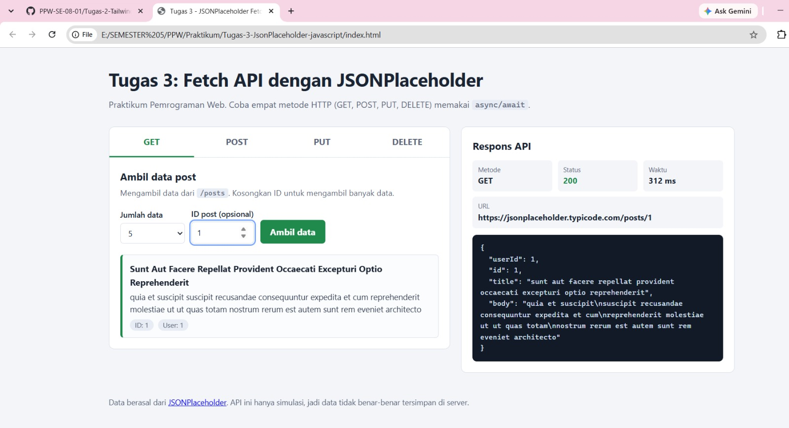
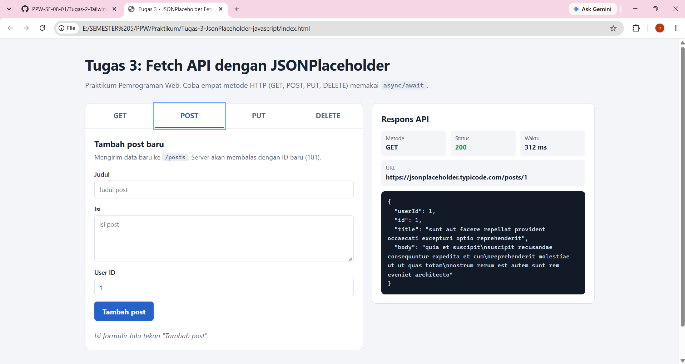
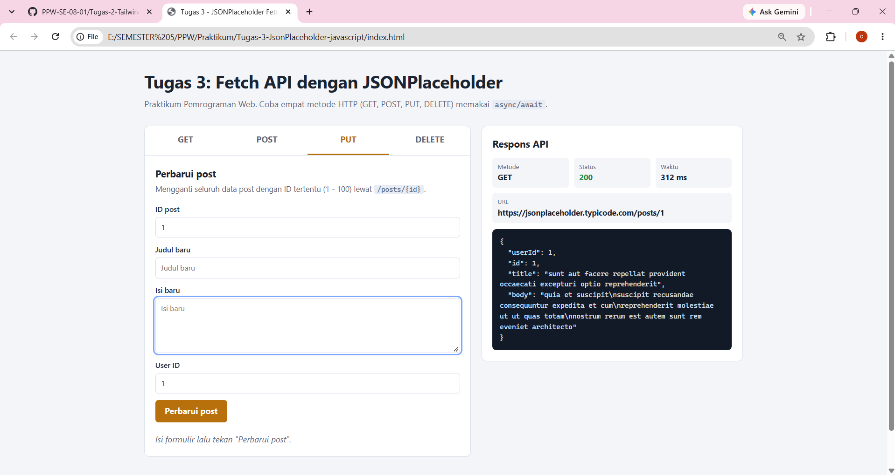
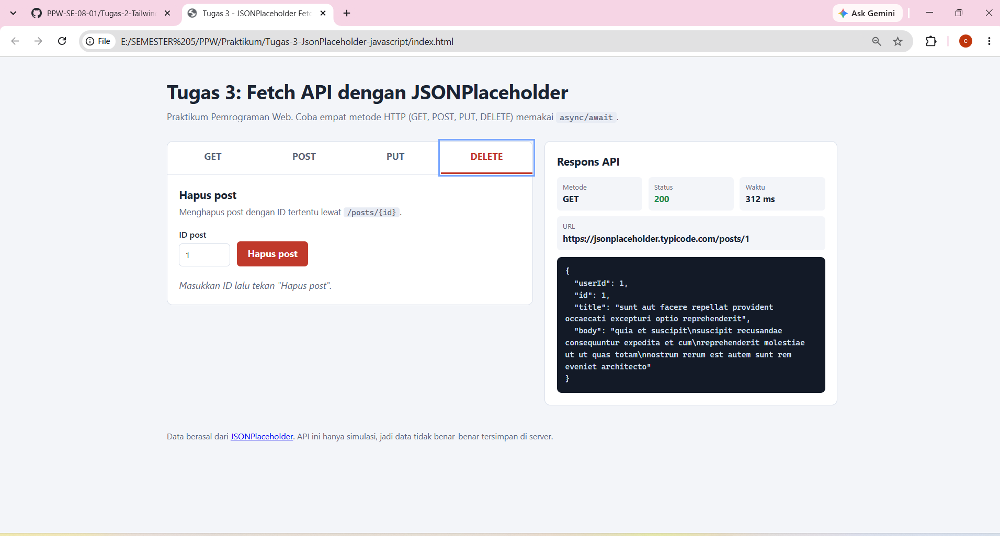

# Tugas-3-JsonPlaceholder-javascript

## Tugas Praktikum Pemrograman Web: Fetch API & Asynchronous JavaScript

Aplikasi web sederhana untuk mencoba **Fetch API** dari [JSONPlaceholder](https://jsonplaceholder.typicode.com/) menggunakan JavaScript asynchronous (`async/await`). Keempat metode HTTP (**GET, POST, PUT, DELETE**) diimplementasikan, dan hasil respons API di-*mapping* lalu ditampilkan ke HTML menggunakan JavaScript DOM.

---

## Identitas

| Keterangan | Isi |
|---|---|
| Nama | Chiara Calina Devi |
| NIM | 103122400016 |
| Kelas | SE08-01 |
| Mata Kuliah | Perancangan dan Pemrograman Web |

---

## Teknologi

- HTML5
- CSS3 (Grid, Flexbox, CSS Variables)
- JavaScript ES6+ (`async/await`, `fetch`, `try/catch`, DOM manipulation)
- API: `https://jsonplaceholder.typicode.com/posts`

---

## Struktur File

```
Tugas-3-JsonPlaceholder-javascript/
├── index.html        # Struktur halaman (tab GET, POST, PUT, DELETE + panel respons)
├── style.css         # Tampilan halaman
├── script.js         # Logika Fetch API dan manipulasi DOM
├── README.md         # Laporan hasil praktikum
└── screenshots/      # Tangkapan layar hasil pengujian
```

---

## Cara Menjalankan

Tidak perlu instalasi apa pun, tetapi **harus terhubung ke internet** karena memanggil API publik.

### Cara 1: Langsung dari browser
1. Unduh atau *clone* repository ini.
2. Buka file `index.html` dengan dua kali klik (atau klik kanan, lalu *Open with* Chrome/Edge/Firefox).

### Cara 2: VS Code + Live Server (disarankan)
1. Buka folder proyek di VS Code.
2. Pasang ekstensi **Live Server**.
3. Klik kanan `index.html`, lalu pilih **Open with Live Server**.
4. Halaman terbuka di `http://127.0.0.1:5500`.

### Cara 3: Server lokal lewat terminal
```bash
# Python 3
python -m http.server 8000
# lalu buka http://localhost:8000

# atau Node.js
npx serve .
```

### Clone dari GitHub
```bash
git clone https://github.com/<chiaracn>/Tugas-3-JsonPlaceholder-javascript.git
cd Tugas-3-JsonPlaceholder-javascript
```

---

## Cara Memakai Aplikasi

1. **GET**: halaman otomatis memuat 10 data. Ubah jumlah data atau isi ID untuk mengambil satu post, lalu klik **Ambil data**.
2. **POST**: isi judul, isi, dan User ID, lalu klik **Tambah post**.
3. **PUT**: isi ID post (1 sampai 100) beserta data barunya, lalu klik **Perbarui post**.
4. **DELETE**: isi ID post, lalu klik **Hapus post**.
5. Panel **Respons API** di kanan menampilkan metode, status HTTP, waktu respons, URL, dan JSON mentah dari server.

---

## Penjelasan Implementasi

Semua permintaan melewati satu fungsi pembungkus `request(method, url, payload)` di `script.js` yang memakai `fetch` dengan `async/await`, memeriksa `response.ok`, menghitung waktu respons, dan menangani error dengan `try/catch`.

### 1. GET: mengambil data
```js
async function getPosts(limit) {
  return request("GET", `${POSTS_URL}?_limit=${limit}`);
}
```
Array hasil API di-*mapping* menjadi kartu HTML lewat `posts.map(...)` pada fungsi `renderPosts`.

### 2. POST: menambah data
```js
async function createPost(newPost) {
  return request("POST", POSTS_URL, newPost);
}
```
Data dikirim sebagai JSON (`JSON.stringify`) dengan header `Content-Type: application/json`. Server membalas dengan data baru beserta `id: 101`.

### 3. PUT: memperbarui data
```js
async function updatePost(id, updatedPost) {
  return request("PUT", `${POSTS_URL}/${id}`, updatedPost);
}
```
Data post dengan ID tertentu diganti seluruhnya, lalu hasilnya ditampilkan.

### 4. DELETE: menghapus data
```js
async function deletePost(id) {
  return request("DELETE", `${POSTS_URL}/${id}`);
}
```
Server membalas dengan objek kosong `{}` dan status `200 OK` sebagai tanda berhasil.

### Penanganan Error dan Keamanan
- Status selain 2xx dianggap gagal dan pesannya ditampilkan di layar.
- Gangguan jaringan ditangkap (`TypeError` dari `fetch`) dan diberi pesan yang jelas.
- Tombol submit dinonaktifkan selama proses berlangsung untuk mencegah klik ganda.
- Konten dari API dimasukkan memakai `textContent`, bukan `innerHTML`, supaya aman dari injeksi HTML.

---

## Hasil Pengujian

| No | Metode | Endpoint | Hasil yang Diharapkan | Status |
|----|--------|----------|-----------------------|--------|
| 1 | GET | `/posts?_limit=10` | Daftar 10 post tampil | 200 OK |
| 2 | GET | `/posts/1` | Satu post dengan ID 1 tampil | 200 OK |
| 3 | POST | `/posts` | Post baru dibalas dengan `id: 101` | 201 Created |
| 4 | PUT | `/posts/1` | Data post ID 1 terganti | 200 OK |
| 5 | DELETE | `/posts/1` | Respons `{}` | 200 OK |

### Tangkapan Layar
Simpan gambar di folder `screenshots/`, lalu tampilkan di sini:

```md




```

---

## Catatan Penting

JSONPlaceholder adalah API **simulasi**. Permintaan POST, PUT, dan DELETE dibalas seolah-olah berhasil, tetapi data **tidak benar-benar berubah** di server. Karena itu, GET ulang akan tetap menampilkan data aslinya. Ini perilaku normal API tersebut.

Selain itu, PUT hanya bekerja untuk ID 1 sampai 100. ID di luar rentang itu dibalas error `500` oleh server.

---

## Referensi

- JSONPlaceholder: https://jsonplaceholder.typicode.com/
- Dokumentasi Fetch API: https://developer.mozilla.org/en-US/docs/Web/API/Fetch_API
