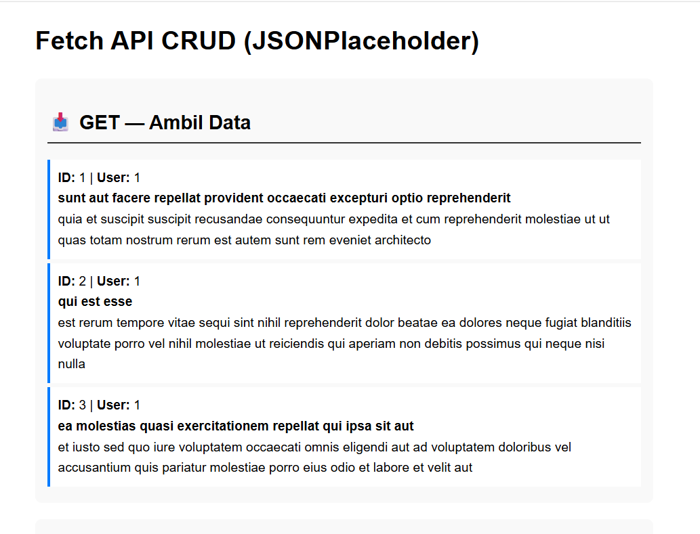
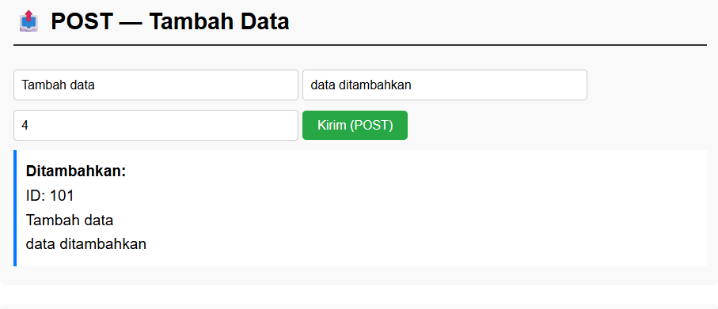
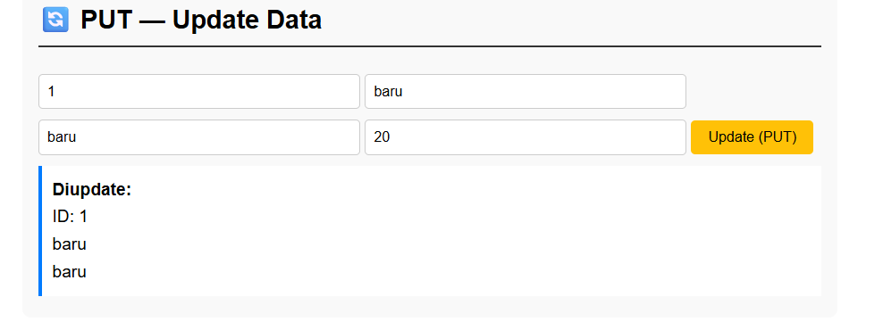
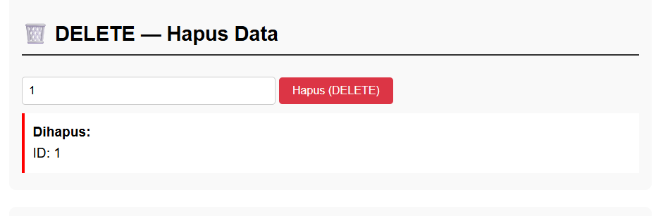

Web sederhana yang mengimplementasikan Fetch API. Setiap metode HTTP memanggil endpoint JSONPlaceholder dan menampilkan hasilnya secara langsung ke halaman HTML. Respons API juga dapat diperiksa melalui area Respons API yang menampilkan JSON mentah.

## Screenshot Output

### GET — Ambil Data


### POST — Tambah Data


### PUT — Update Data


### DELETE — Hapus Data


### Respons API
- Response POST: 
- Response PUT: 
- Response DELETE: 

## Struktur File

```
103122400021_Tony Hendrawan/
├── README.md
├── assets/
│   ├── get.png
│   ├── post.png
│   ├── put.png
│   ├── delete.png
│   ├── response post.png
│   ├── response put.png
│   └── response delete.png
└── source_code/
    ├── index.html
    ├── style.css
    └── script.js
```
