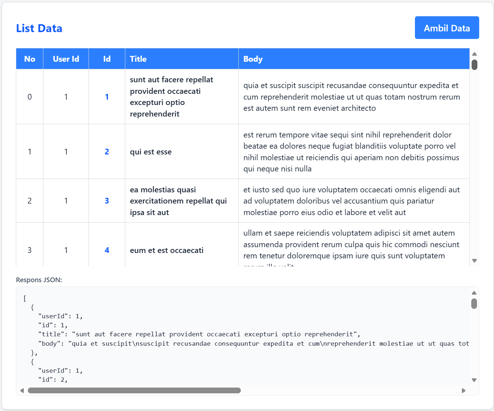
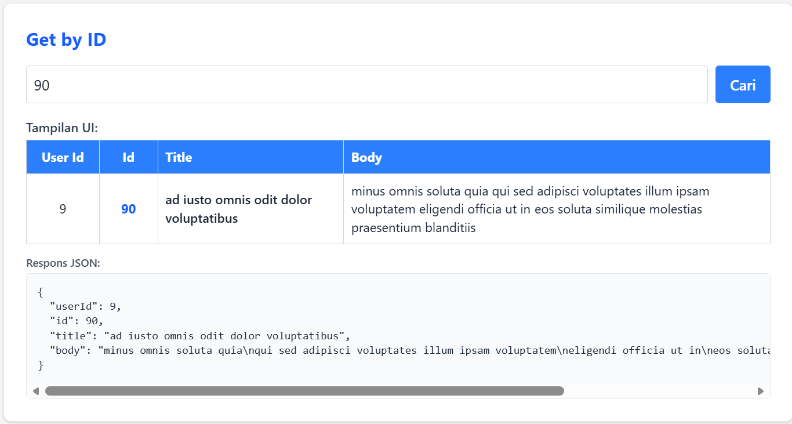
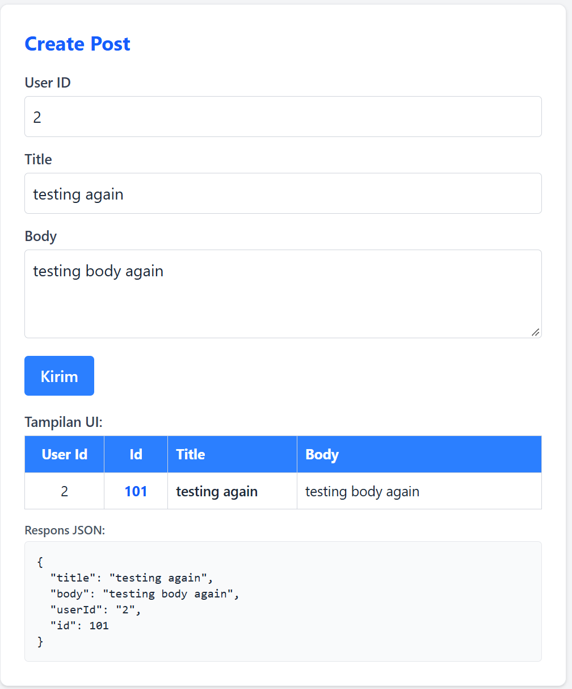
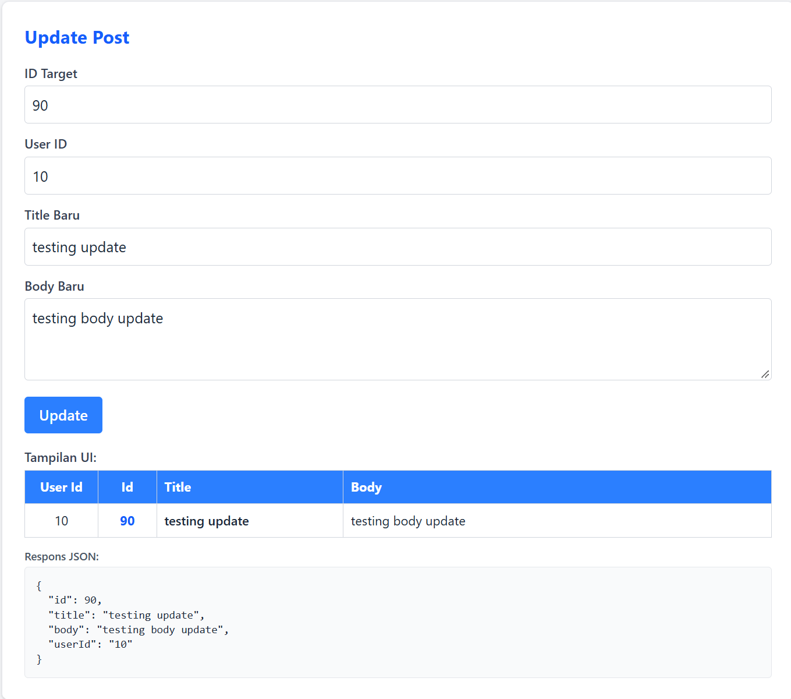
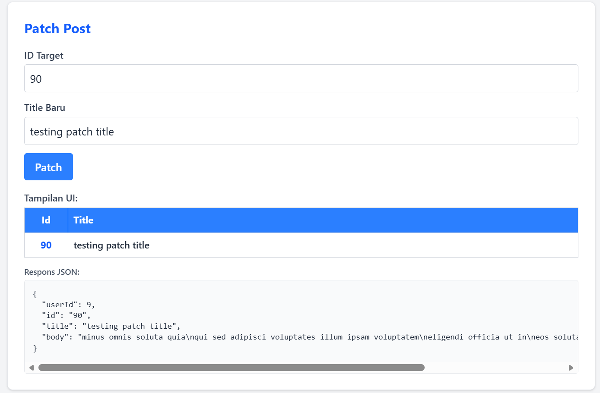
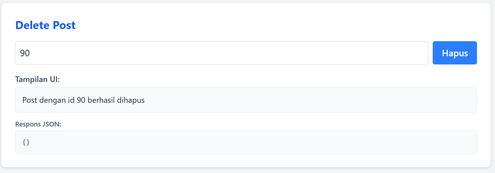

# Laporan Praktikum Tugas 3 - Fetch API

Laporan hasil praktikum mata kuliah **Perancangan dan Pemrograman Web** mengenai implementasi metode HTTP menggunakan Fetch API dan manipulasi JavaScript DOM dengan data dari JSONPlaceholder.

---

## Identitas Mahasiswa

* **Nama:** Geusan Edurais Aria Daffa
* **NIM:** 103122400026
* **Kelas:** SE - 08 - 01

---

## Deskripsi Singkat Proyek

Proyek ini bertujuan untuk mempelajari dan mempraktikkan cara melakukan request ke server menggunakan **Fetch API** (`async/await`) serta menampilkan hasil responsnya ke antarmuka web (HTML) secara dinamis menggunakan **JavaScript DOM**.

Endpoint yang digunakan berasal dari API publik [JSONPlaceholder](https://jsonplaceholder.typicode.com/posts). Terdapat 5 metode HTTP yang diuji:
1. **GET (All)** - Mengambil seluruh data post.
2. **GET (by ID)** - Mengambil 1 post spesifik berdasarkan ID.
3. **POST** - Menambahkan post baru.
4. **PUT** - Memperbarui data post secara keseluruhan.
5. **PATCH** - Memperbarui sebagian atribut post (title).
6. **DELETE** - Menghapus post berdasarkan ID.

Setiap fitur menampilkan dua jenis output:
* **Tampilan UI**: Data di-mapping ke dalam baris tabel HTML (`<tr><td>`).
* **Respons JSON**: Respons mentah asli dari API ditampilkan pada tag `<pre>` untuk memeriksa status dan objek data.

---

## Teknologi yang Digunakan

* **HTML5**: Struktur halaman web.
* **Tailwind CSS v4 (CDN)**: Penataan tampilan dan tata letak antarmuka.
* **JavaScript (Vanilla / ES6+)**: Logika request dan manipulasi DOM.
* **Fetch API**: Mengirim HTTP request ke API secara asinkron.
* **JSONPlaceholder**: Layanan fake REST API untuk keperluan pengujian.

---

## Struktur Folder

```text
103122400026_GeusanEduraisAriaDaffa/
├── assets/
│   ├── list_data_post.png
│   ├── get_by_id_post.png
│   ├── create_post.png
│   ├── update_post.png
│   ├── patch_post.png
│   └── delete_post.png
├── index.html
├── scripts.js
└── README.md
```

---

## Hasil Pengujian & Screenshot

### 1. GET - Mengambil Semua Data Post
Mengambil seluruh data array post dari endpoint `/posts`. Data di-looping dan di-mapping ke baris tabel utama.



---

### 2. GET by ID - Mengambil Satu Data Post
Mengambil satu post spesifik berdasarkan ID yang dimasukkan ke endpoint `/posts/:id`. Hasilnya ditampilkan pada tabel 1 baris.



---

### 3. POST - Menambahkan Data Baru
Mengirimkan data post baru (User ID, Title, dan Body) ke endpoint `/posts` menggunakan metode `POST`. Server mengembalikan respons simulasi dengan ID baru (101).



---

### 4. PUT - Memperbarui Seluruh Data Post
Memperbarui seluruh data post pada ID yang ditentukan ke endpoint `/posts/:id` menggunakan metode `PUT`.



---

### 5. PATCH - Memperbarui Sebagian Data Post
Memperbarui hanya atribut tertentu (Title) tanpa mengubah seluruh properti post ke endpoint `/posts/:id` menggunakan metode `PATCH`.



---

### 6. DELETE - Menghapus Data Post
Mengirimkan request untuk menghapus data post berdasarkan ID tertentu ke endpoint `/posts/:id` menggunakan metode `DELETE`. Server mengembalikan respons sukses `{}` (status 200).



---

## Cara Menjalankan Proyek

1. Pastikan komputer terhubung dengan internet (karena Tailwind CSS dan endpoint JSONPlaceholder membutuhkan koneksi).
2. Buka file `index.html` langsung melalui browser (klik dua kali atau klik kanan > *Open with* browser favorit Anda).
3. Anda juga dapat menggunakan ekstensi **Live Server** di VS Code untuk kemudahan pengujian.

---

## Kesimpulan

Berdasarkan praktikum yang telah dilakukan:
1. Fetch API mempermudah pertukaran data secara asinkron dengan server menggunakan metode `async/await`.
2. Hasil data JSON dapat langsung di-mapping ke elemen HTML (tabel) menggunakan manipulasi DOM (`innerHTML` atau manipulasi node).
3. Keempat metode HTTP utama (GET, POST, PUT, DELETE) serta PATCH berhasil diuji coba dan menghasilkan respons yang sesuai dengan spesifikasi RESTful API.

