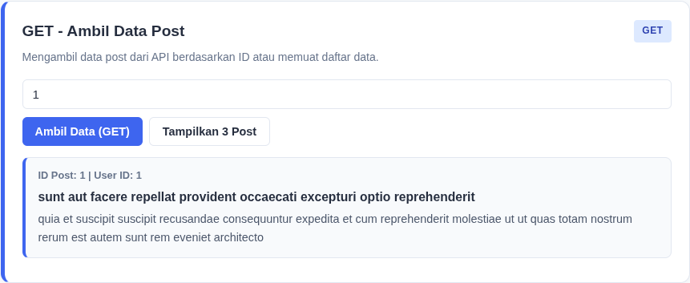
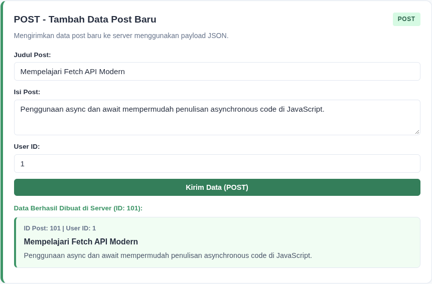
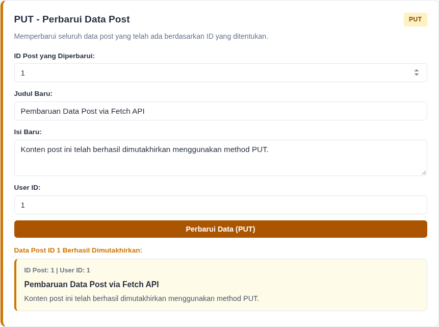
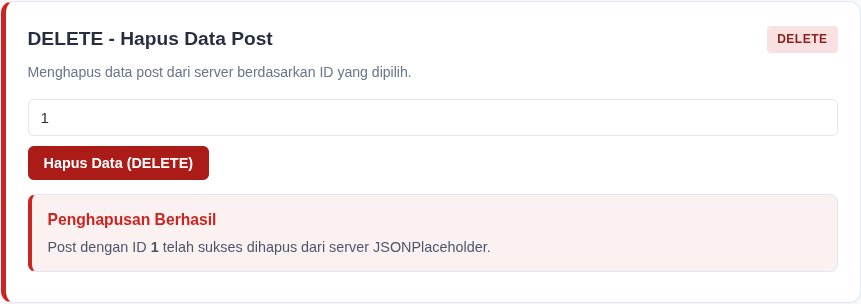
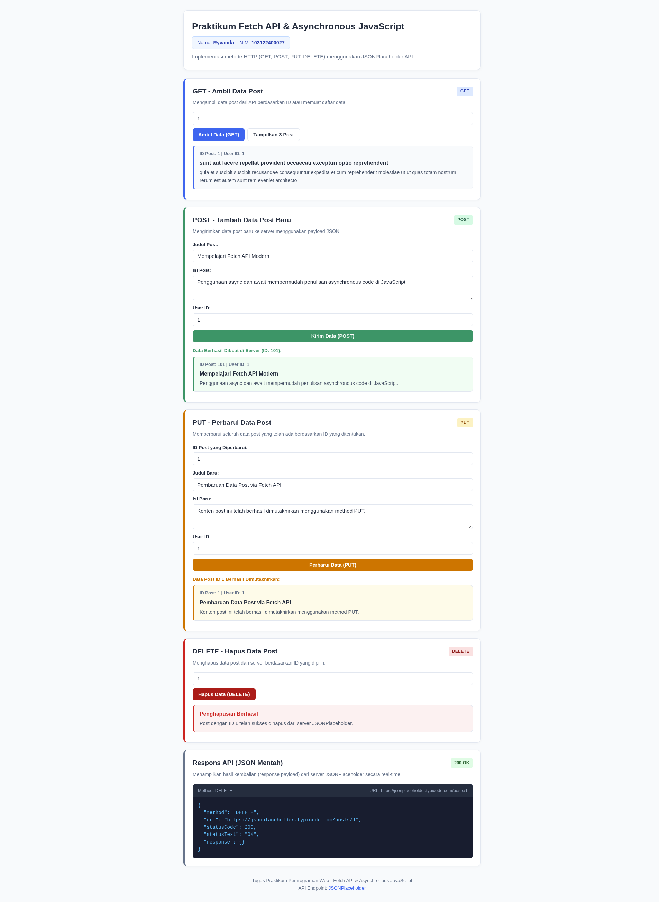

# Laporan Praktikum Pemrograman Web - Minggu 3

## Identitas Mahasiswa
- **Nama:** Ryvanda
- **NIM:** 103122400027
- **Mata Kuliah:** Pemrograman Web
- **Topik:** Fetch API & Asynchronous JavaScript (CRUD JSONPlaceholder)

---

## Deskripsi Singkat

Aplikasi web ini dibangun untuk memenuhi tugas praktikum pemrograman web minggu ke-3. Aplikasi mengimplementasikan Fetch API dengan paradigma asynchronous JavaScript (`async/await`) untuk melakukan interaksi CRUD terhadap mock REST API di JSONPlaceholder.

Setiap aksi HTTP (GET, POST, PUT, DELETE) memproses permintaan ke endpoint dan langsung memetakan (mapping) hasilnya ke dalam elemen HTML (DOM). Selain itu, terdapat panel **Respons API (JSON Mentah)** pada bagian bawah aplikasi yang menampilkan status code, URL, method, serta payload respons JSON mentah secara real-time.

---

## Screenshot Output Pengujian

### 1. GET — Ambil Data
Menampilkan data post dari endpoint `https://jsonplaceholder.typicode.com/posts/{id}`. Saat halaman pertama kali dimuat, data post otomatis diambil dan ditampilkan ke antarmuka kartu.



---

### 2. POST — Tambah Data
Mengirimkan data post baru (judul, isi, user ID) menggunakan method `POST` dengan format JSON ke endpoint `/posts`. Server mengembalikan respons data yang telah berhasil dibuat beserta ID barunya (ID: 101).



---

### 3. PUT — Update Data
Memperbarui seluruh data post yang sudah ada berdasarkan ID yang ditentukan melalui HTTP method `PUT`. Antarmuka menampilkan status pembaruan dan data post yang telah dimutakhirkan.



---

### 4. DELETE — Hapus Data
Menghapus post dari server berdasarkan ID melalui HTTP method `DELETE`. Setelah permintaan sukses, antarmuka menampilkan konfirmasi penghapusan.



---

### 5. Respons API (JSON Mentah)
Area ini menampilkan status HTTP (seperti 200 OK, 201 Created) serta payload JSON mentah yang dikembalikan oleh server JSONPlaceholder:

- **Respons POST:**
  

- **Respons PUT:**
  

- **Respons DELETE:**
  

---

### 6. Tampilan Lengkap Halaman Web



---

## Struktur File

```text
103122400027_Ryvanda/
├── README.md
├── assets/
│   ├── delete.png
│   ├── full_page.png
│   ├── get.png
│   ├── post.png
│   ├── put.png
│   ├── response delete.png
│   ├── response post.png
│   └── response put.png
└── source_code/
    ├── index.html
    ├── script.js
    └── style.css
```

---

## Penjelasan Teknis Singkat

1. **GET Request (`ambilPost`):**
   Memanggil `fetch(url)` dengan `async/await`. Jika respons berhasil (`response.ok`), data di-parse dengan `await response.json()` dan ditampilkan ke elemen `#output-get`.
2. **POST Request (`tambahPost`):**
   Mengambil nilai dari form input, membungkusnya dalam objek JavaScript, lalu mengirimkannya via `fetch()` dengan `method: 'POST'`, header `'Content-type': 'application/json'`, dan payload `JSON.stringify()`.
3. **PUT Request (`perbaruiPost`):**
   Mengirim pembaruan data ke URL spesifik `posts/{id}` dengan method `PUT` dan memetakan hasil yang telah diperbarui.
4. **DELETE Request (`hapusPost`):**
   Mengirim perintah hapus ke `posts/{id}` dengan method `DELETE` dan menampilkan pesan konfirmasi pada antarmuka.
5. **Panel Respons Mentah (`tampilkanResponsMentah`):**
   Fungsi pembantu yang mencatat method, URL, status code HTTP, dan isi JSON kembalian ke dalam elemen `<pre>` dengan format terstruktur.

---

## Cara Menjalankan

### Cara 1: Buka Langsung di Browser
1. Masuk ke direktori `103122400027_Ryvanda/source_code/`.
2. Klik ganda file `index.html` untuk membukanya di browser web.

### Cara 2: Menjalankan via Local HTTP Server
```bash
cd "103122400027_Ryvanda/source_code"
python3 -m http.server 8000
```
Buka browser dan akses alamat: `http://localhost:8000`

