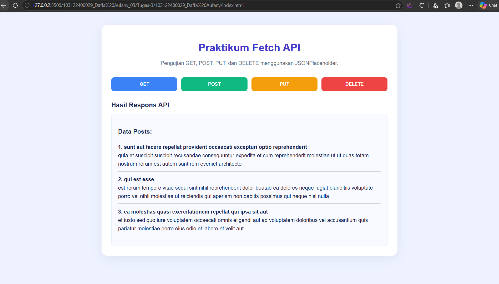
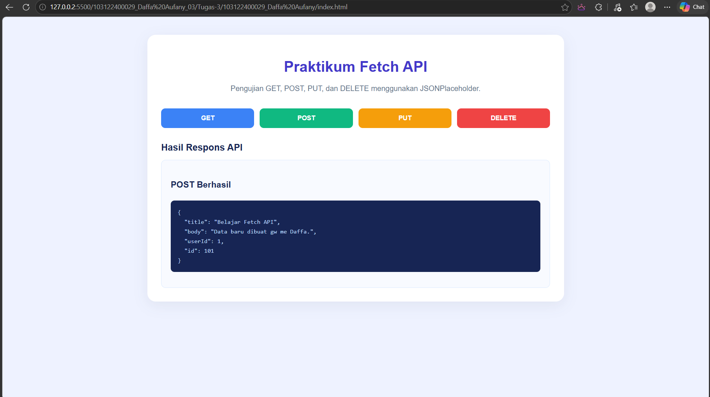
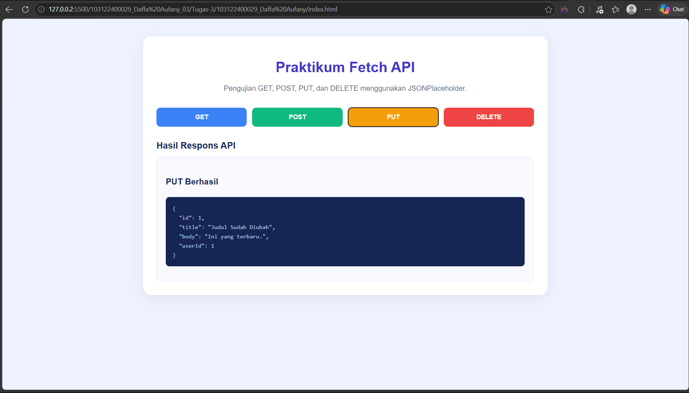
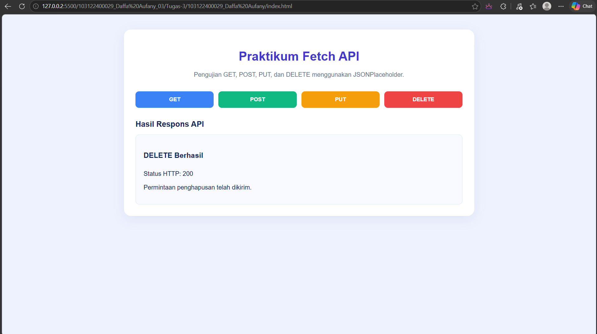

# Praktikum Fetch API - Asynchronous JavaScript

## Deskripsi
Project ini dibuat untuk memenuhi tugas praktikum Perancangan dan Pemrograman Web. Aplikasi sederhana ini menggunakan Fetch API dan JavaScript `async/await` untuk melakukan komunikasi dengan API JSONPlaceholder.

## Fitur
- **GET** — Mengambil dan menampilkan data posts dari API.
- **POST** — Mengirim data post baru ke API.
- **PUT** — Memperbarui data post dengan ID 1.
- **DELETE** — Mengirim permintaan penghapusan data post dengan ID 1.

## Teknologi yang Digunakan
- HTML
- CSS
- JavaScript
- Fetch API
- JSONPlaceholder

## API yang Digunakan
JSONPlaceholder: https://jsonplaceholder.typicode.com/posts

API ini digunakan sebagai layanan simulasi untuk pengujian permintaan HTTP tanpa perlu membuat backend sendiri.

## Output 

### GET

### POST

### PUT

### DELETE

## Kesimpulan
Melalui praktikum ini, saya mempelajari cara menggunakan Fetch API dengan `async/await`, memahami metode HTTP GET, POST, PUT, dan DELETE, serta menampilkan respons API menggunakan manipulasi DOM pada JavaScript.

**Catatan:** JSONPlaceholder merupakan API simulasi. Permintaan POST, PUT, dan DELETE memberikan respons seolah-olah data berhasil diproses, tetapi perubahan tersebut tidak disimpan secara permanen.
