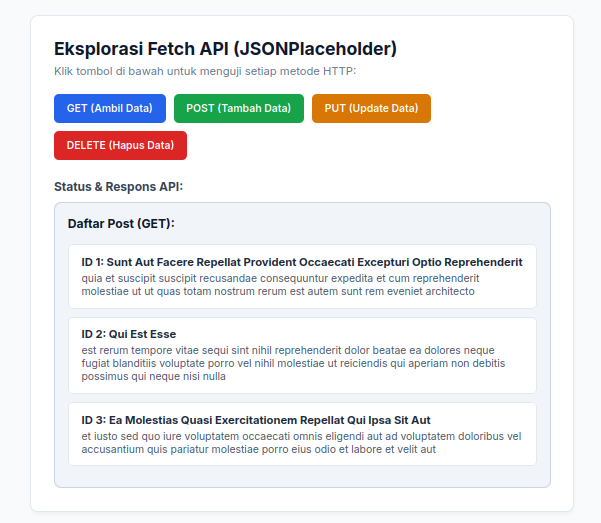
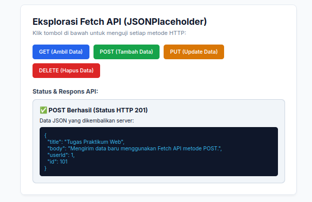
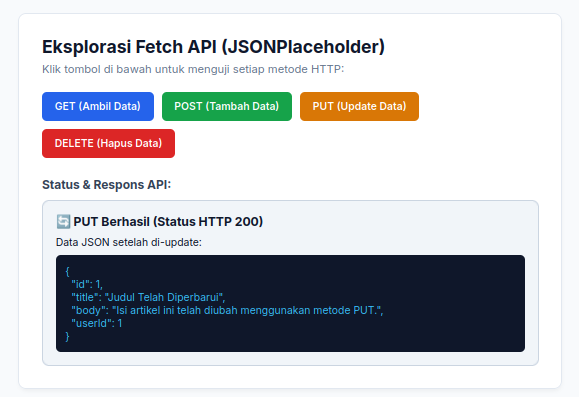
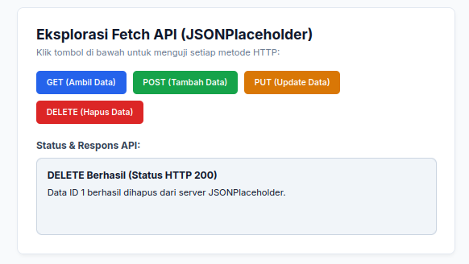

# Praktikum Fetch API & Asynchronous JavaScript

## Nama : Davis Arvaputra Dwiansyah
## NIM : 10312240034

Web sederhana yang mengimplementasikan Fetch API menggunakan JavaScript asynchronous (`async/await`). Aplikasi ini memicu empat metode HTTP dasar (CRUD) yang memanggil endpoint dari **JSONPlaceholder** dan menampilkan hasilnya secara interaktif ke halaman HTML. Respons API juga dapat diperiksa secara langsung melalui area tampilan yang menyajikan data JSON mentah.

---

## Fitur

- **GET**: Mengambil data artikel dari API dan merendernya ke tampilan HTML.
- **POST**: Mengirim data artikel baru ke server dan menampilkan respons status `201 Created` beserta payload JSON.
- **PUT**: Memperbarui data artikel yang ada dan menampilkan hasil perubahan JSON.
- **DELETE**: Mengirim permintaan penghapusan data dan menampilkan konfirmasi status HTTP.

---

- **REST API**: [JSONPlaceholder](https://jsonplaceholder.typicode.com/) (Fake Online REST API).

---

## Screenshot Output

### GET — Ambil Data

### POST — Tambah Data

### PUT — Update Data

### DELETE — Hapus Data

